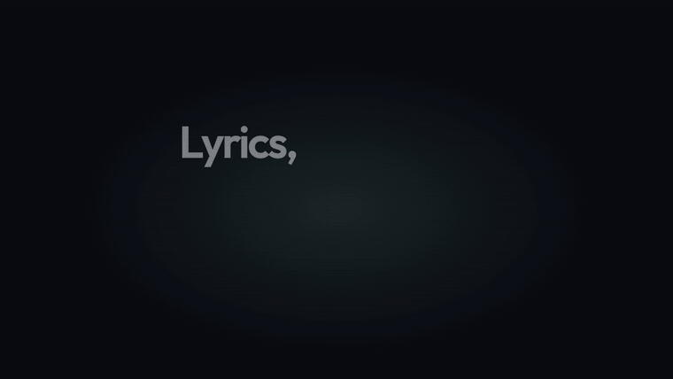

# Lirico

Time-synced lyrics for whatever is playing on your Windows PC, line by line,
**right in your taskbar** (or beside any window's minimise button, or floating anywhere).

<p align="center"><a href="https://getlirico.pages.dev"></a></p>

<p align="center">
  <a href="https://getlirico.pages.dev/download?src=readme"><b>⬇ Download Lirico.exe</b></a> ·
  <a href="https://getlirico.pages.dev">Website</a> ·
  <a href="https://github.com/sumitakhuli/Lirico/releases/latest/download/lirico-explainer.mp4">Watch the 25 s video (MP4)</a>
</p>

Free, one file, Windows 10 / 11. No account, no setup.

- **Finds the song by itself**: YouTube in Chrome/Edge, Spotify, any player in Windows' media controls.
- **Lives in your taskbar's empty space**, also with auto-hide. Drag the lyrics near the taskbar,
  or next to a window's minimise button, and they **snap on like a magnet**.
- **Sync first**: picks the lyrics version timed to the exact recording, and **listens for the singer**
  so music-video intros don't make lyrics start early.
- Hindi songs in **English letters (Hinglish)** by default; Devanagari is one switch away.
- Long lines wrap onto two balanced rows instead of being cut off.
- Settings for font, size, colours, background, animations, hotkeys, with quick switches in the sidebar.
- Starts with Windows and waits in the tray (turn off in Settings).

> First launch: Windows SmartScreen may say "Windows protected your PC". Click
> **More info → Run anyway** (the exe isn't code-signed yet).

**Privacy.** Lyrics come from [LRCLIB](https://lrclib.net). Auto-sync listens to your PC's audio
*on your PC only*; nothing is recorded, saved or sent. Lirico shares **anonymous usage counts**
(minutes used, songs found or not, app version), never song names, lyrics or audio. Turn it off in
Settings → Behavior. The website counts visits without cookies.

## Run it

**Single file:** download `Lirico.exe` from [Releases](https://github.com/sumitakhuli/Lirico/releases)
and double-click it. No Python needed.

**From source** (Python 3.10+):

```bat
setup.bat        :: once: creates .venv and installs dependencies
run.bat          :: starts Lirico in the background (tray icon appears)
run-debug.bat    :: with a console and verbose logs
```

## Using it

- **Drag** the lyrics anywhere with the mouse. *Settings → Behavior → Dock above taskbar* puts them back.
- **Right-click** the lyrics, or the tray icon, for the menu. **Left-click** the tray icon to show
  or hide them. **Double-click** it for Settings.
- They hide automatically when a video or game goes **fullscreen**. Press the show/hide hotkey to
  bring them in front anyway.

### Hotkeys (work in any app; change them in Settings → Hotkeys)

| Default | Action |
|---|---|
| `Ctrl+Alt+Space` | Show / hide lyrics (in fullscreen: bring them to the front) |
| `Ctrl+Alt+Up` | **Tap-sync:** press when the singer starts the upcoming (small) line |
| `Ctrl+Alt+Right` / `Left` | Lyrics earlier / later by 0.25 s |
| `Ctrl+Alt+Down` | Reset this song's sync |
| `Ctrl+Alt+N` | Try another lyrics version |

`Ctrl+Space` and `Alt+Space` aren't the defaults because they're already taken: autocomplete in
VS Code and IDEs, the window menu, and PowerToys Run. You can still assign them in Settings.

Per-song sync and your chosen lyrics version (tray → *Lyrics version*) are remembered for the
next time that video or song plays.

## Settings & customizing

**Settings** (tray → Settings…) changes everything live: font, size, weight, colors, background
color and opacity, corner radius, width, shadow, next line, the progress underline, animation style
and speed, opacity while paused, fullscreen behavior, lock (click-through), start with Windows,
"show lines early by", Hindi script, and hotkeys.

Factory defaults for every visual value live in **[`lirico/theme.py`](lirico/theme.py)**. Your
changes are saved as overrides in `%USERPROFILE%\.lirico\settings.json`, next to the cache and
`lirico.log`. Set `LIRICO_HOME` to use another folder. To preview styling without music:
`.venv\Scripts\python tools\render_preview.py preview`.

## Auto-sync: listening for the singer

Video intros (scenes, dialogue, music lead-ins) used to make lyrics start too early, mostly
on Hindi songs. Lirico now listens to what your PC plays (system audio only, never the
microphone; processed on this PC, never saved or sent). A small bundled speech model (Whisper
tiny) recognizes sung words, and the time shift that lines them up with the lyrics is found by
voting. It locks on usually 10–20 s after the singing starts. Until then it shows
"♪ Title — Artist" instead of early lyrics. The result is remembered per song.
Settings → Sync & Lyrics turns it off; tray → Sync → "Listen again" re-detects.

## How sync works (and what was measured)

1. **Playback clock.** Windows reports "position P at time T". Lirico extrapolates on a local
   clock and re-anchors on play, pause, seek and rate changes. Measured against YouTube's own
   `video.currentTime` in Chrome (`tools/yt_sync_probe.py`), the error stays within **0.1 s**
   through seeks, pauses, paused seeks, resume and 1.25× speed.
2. **Following the right tab.** Every Chrome/Edge tab is its own media session, and they all
   share the app id "Chrome". Lirico follows a session by app + title, so pausing your song never
   switches to another paused tab. That was the main cause of lyrics drifting badly after a pause.
   A duration guard also rejects any timeline that doesn't belong to the song.
3. **Right lyrics version.** LRCLIB often holds several timings of one song. Lirico searches broadly
   (up to 7 queries, including the raw video title and the artist it discovers), then picks the
   best title/artist match with a steep penalty for duration mismatch. On 72 real YouTube results
   (Hindi, Punjabi, rap, English; `tests/data/yt_corpus.json`), **76% get lyrics timed to that exact
   video** (`tools/eval_matching.py`), and the rest get the right song in another version, or an honest "not found".
4. **When no exact version exists** (e.g. a "Full Video" edit 100 s shorter than the song), Lirico
   says so briefly. Tap-sync once (`Ctrl+Alt+Up`) or use tray → Sync → "Video has an intro? Shift
   N s". The fix is remembered for that video.
5. **English letters, correct timing.** If the best-timed lyrics are in Devanagari, the text from a
   romanized version with the same lines is moved onto those timings, or the Devanagari is
   transliterated (हम तेरे बिन → "Ham tere bin").

## Build the .exe

```bat
.venv\Scripts\python -m pip install -r requirements-dev.txt
.venv\Scripts\python build_exe.py --get-model   :: once: downloads the Whisper tiny model (~75 MB)
.venv\Scripts\python build_exe.py               :: -> dist\Lirico.exe (~150 MB, single file)
```

## Development

```bat
.venv\Scripts\python -m pytest
```

| Tool | What it does |
|---|---|
| `tools/yt_sync_probe.py "query" …` | Plays YouTube songs in a throwaway Chrome profile and measures Lirico's clock against the real video position |
| `tools/yt_corpus.py out.json "query" …` | Collects real YouTube titles, channels and durations for matching tests |
| `tools/eval_matching.py corpus.json` | Runs the full lyrics matcher over a corpus and reports how many are timed to the exact video |
| `tools/find_lyrics.py "<title>" "<channel>" --duration 262` | One lookup, as the app would do it |
| `tools/fake_player.py --title … --script "0:play 12:seek=100 20:pause"` | A real, muted Windows media session for testing |
| `tools/probe_media.py` | Prints what Lirico sees from Windows media controls |
| `tools/render_preview.py` | Renders the overlay styling to PNGs |

## Project layout

`lirico/` app source · `tests/` unit tests and the YouTube matching corpus · `tools/` dev tools ·
`brand/` logo · `web/` the website + download counter + stats (Cloudflare Worker, D1) ·
`marketing/` the explainer videos (HyperFrames projects) and renders · `docs/` README media · `THIRD_PARTY_NOTICES.md` bundled open-source components.
